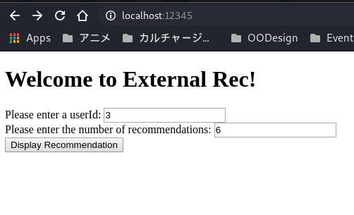
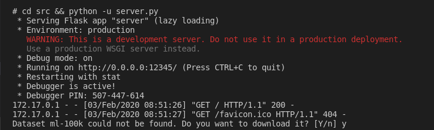
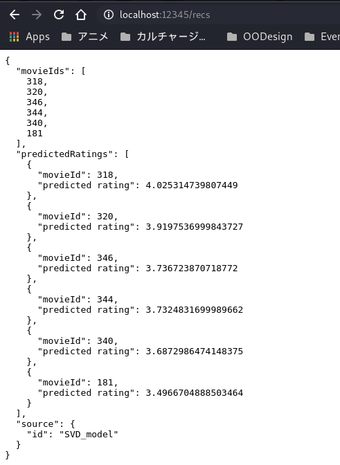

# movies-surprise-flask

A Flask service that returns movie recommendations from a [Surprise](https://surpriselib.com/)
model. It loads a pre-trained dump, predicts ratings for every movie a user has
not rated, and returns the top-N ids with their estimated ratings — the scoring
half of a recommender system.

## Run it with Docker

The image installs the dependencies, trains the KNN model at build time, and
exposes port 12345. It has no entrypoint on purpose, so the command starts a
shell and then the server:

```bash
docker build -t movies-surprise-flask .
docker run --rm -it -p 12345:12345 movies-surprise-flask sh
cd src && python -u server.py
```

The base image is `python:3.6-slim-buster`, which is end-of-life; the build
still works, but a newer Python is the obvious next change.

## Run it locally

```bash
pip install -r requirements.txt
pip install scikit-surprise
cd src && python -u server.py
```

`scikit-surprise` is commented out in `requirements.txt` because the Dockerfile
installs it separately after the rest of the dependencies; install it by hand
locally.

## The API

`POST /score` takes JSON and returns the top 10 recommendations for the user:

```bash
curl -s -X POST http://localhost:12345/score \
  -H 'Content-Type: application/json' \
  -d @src/request_test_1.json
```

```json
{
  "source": {"id": "SVD_model"},
  "movieIds": [50, 100, 181, ...],
  "predictedRatings": [{"movieId": 50, "predicted rating": 4.9}, ...]
}
```

`GET /` renders a small form for the same request. `api.py` is a second,
form-based version of the endpoint (`request.form` instead of `request.get_json`,
and it filters by `candidateIds`); `server.py` is the JSON one the Docker
instructions start.

`src/request_test_1.json` is a ready-made request: user 20, candidates 1–299,
excluding 3 and 4, limit 15.

## Models and data

The trained dumps are committed so the service starts without training:

| File | What it is |
|---|---|
| `src/SVD_model` | SVD trained on Surprise's built-in `ml-100k` |
| `src/SVD_model_couchDB` | SVD trained on the ratings stored in CouchDB |
| `src/KNNBasic_model_couchDB` | item-based KNN, trained by `build.py` |

`src/ml-latest-small/` is the MovieLens latest-small dataset;
`src/MovieLens.py` loads it, and `src/build.py` trains and dumps a model.
`src/top_n_recommendations.py` holds the top-N helpers both servers use.

## Layout

```
Dockerfile, docker-entrypoint.sh   image build and the (unused) entrypoint
requirements.txt                   Flask, pandas, numpy, CouchDB client
src/server.py                      JSON /score, port 12345
src/api.py                         form-based /score
src/build.py                       trains and dumps a model
src/top_n_recommendations.py       top-N helpers
src/templates/                     the request form
01.png, 02.png, 03.png             screenshots of the running service
```

## Screenshots





## License

MIT — see [LICENSE](LICENSE).
